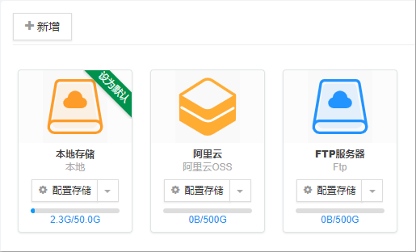
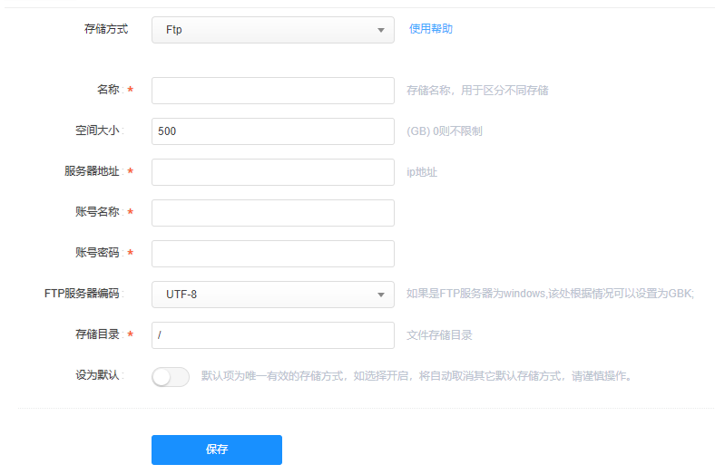
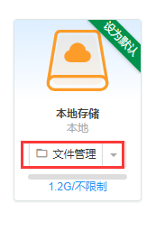

> **部署前建议先读**
>
> - 想对比本地、FTP、WebDAV、OSS/COS/R2/MinIO 等各后端的 CORS、缩略图与限速边界？请先看 [存储策略选型总表](/admin/storage-matrix/)。
> - 想理解为何不能在宿主机直接改默认存储目录、删除文件后为何 S3 未立即释放空间？请看 [虚拟文件系统与存储托管原理](/concepts/storage-architecture/)。
> - 新增的外挂存储默认仅系统管理员可见，如需向普通员工开放，请通过部门绑定或协作分享分发（见 [权限模型](/concepts/permissions-model/)）。

### 4.1.1 多存储融合架构

可道云支持多种存储方式，企业可按需选择一种或多种组合使用：

- **本地存储**：文件保存在服务器本地磁盘
- **FTP 存储**：文件保存在 FTP 服务器上
- **对象存储**：对接阿里云 OSS、七牛云、天翼云、Amazon S3 等云存储服务

多种存储可以并存，方便扩展空间，也可以构建「本地 + 云端」的混合架构。不同存储中的文件都可在可道云中统一管理，并支持跨存储迁移。

{:width="500px"}

### 4.1.2 本地存储挂载

进入 **「存储/文件」→「存储管理」**，点击「新增」添加本地存储：

- **名称**：自定义名称，用于区分不同存储
- **空间大小**：可选，限制该存储目录的容量上限
- **存储目录**：填写服务器上的实际文件夹路径
- **默认存储**：勾选后，新上传的文件将默认存放到此目录

> **注意**
>
> 「默认存储」同一时间只能有一个。切换默认存储会改变系统的文件存放路径，请谨慎操作。
{: .important}

挂载完成后，点击存储名称可进入参数配置页面进行修改。

### 4.1.3 FTP 存储服务器挂载

FTP 存储的配置方式与本地存储类似，除名称、空间大小、存储目录、默认存储外，还需填写：

- FTP 服务器地址
- 登录账号和密码

{:width="600px"}

若 FTP 服务器是 Windows 系统，可将编码设置为 GBK。

### 4.1.4 对象存储挂载

可道云内置了阿里云 OSS、腾讯云 COS、七牛云、百度云 BOS、天翼云、MinIO、Cloudflare R2 及通用 Amazon S3 等对象存储的对接支持。除基本设置外，还需填写 Access Key、Secret Key、Bucket 名称、地域节点（Endpoint）等参数。

> **说 明**
>
> 创建 Bucket 后，**必须正确配置跨源资源共享（CORS，含暴露 `ETag` 响应头）**，才能在可道云中正常使用浏览器直传与大文件分片上传。各主流厂商参数与可直接复制的 CORS 模板请查看：[多云对象存储实战指南（OSS / COS / MinIO / R2 / S3）](/admin/storage-s3/)。

### 4.1.5 存储切换/扩容

挂载多个存储后，可将其中任意一个设为「默认存储」，之后新上传的文件会存放到新的默认位置。

> **注意**
>
> 切换默认存储后，**已有文件不会自动迁移**到新存储。请勿移除或断开之前的默认存储挂载，并确保其路径仍可正常访问，否则可能导致已有文件无法打开。
{: .important}

### 4.1.6 存储文件管理

点击挂载存储的「文件管理」按钮，可直接浏览和管理该存储中的文件，操作方式与网盘文件管理相同。

{:width="200px"}

>**注意**
>
> 对于当前或曾经设为「默认存储」的挂载目录，请勿修改、移动或删除可道云系统自动生成的文件，否则可能导致系统异常。
{: .important}

### 4.1.7 存储间数据迁移

挂载多个存储后，可通过「文件管理」进入某个存储，将文件复制或剪切到另一个挂载存储，实现跨存储迁移。

> **说 明**
>
> 也可以将存储目录添加到收藏夹，方便快速访问和管理。

