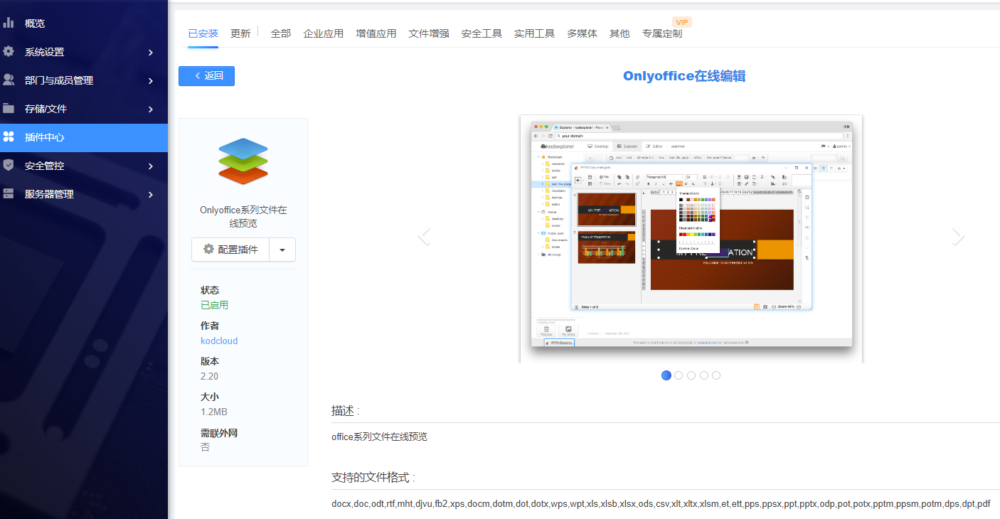

### 插件安装

在线安装：后台管理——插件中心——选择要安装的插件, 直接安装

离线安装：后台管理——插件中心——离线安装

> **注意**
>
> 1. 服务器不支持连接外网.
> 2. 虚拟主机商禁用了相关功能时(网络请求,https验证).

- 安装: 下载后上传解压到plugins目录(需要保留插件名的文件夹,不能修改插件名);插件中心启用即可
- 更新: 下载后上传解压覆盖到到对应插件名文件夹

### 插件说明

在插件中心点击任意插件的logo, 可以查看插件详情, 包括插件描述、支持的格式说明、插件版本等。
{:width="800px"}

### 配置插件

- **使用权限配置**：支持插件权限配置为所有人使用、指定部门使用、指定用户使用以及指定部门和用户使用
- **支持格式**：关联扩展名到该插件, 介绍该插件支持的文件格式
- **扩展名关联优先级设置**：越大扩展名打开优先级越高
    {:width="500px"}

> **说明**
>
> 优先级一般出现在由同样功能的插件中, 比如office阅读器的优先级为1000、officelive优先级为50, 此时打开一个office文档, 使用的会是优先级更高的office阅读器。
>

### 插件卸载/禁用

在对应插件点击倒三角形, 选择卸载/禁用插件

- 卸载插件：彻底删除相关插件配置和插件
- 禁用插件：无法使用该插件, 但插件配置信息依旧保存, 配置恢复能够直接使用, 不需要再次安装。
    {:width="200px"}

