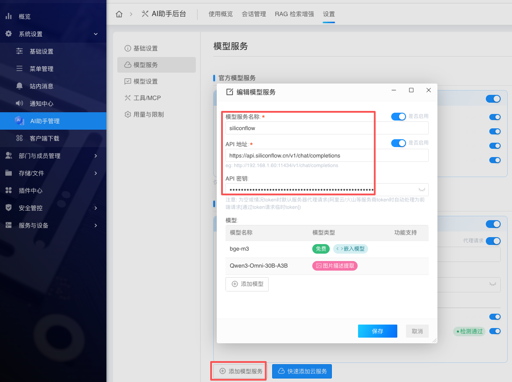
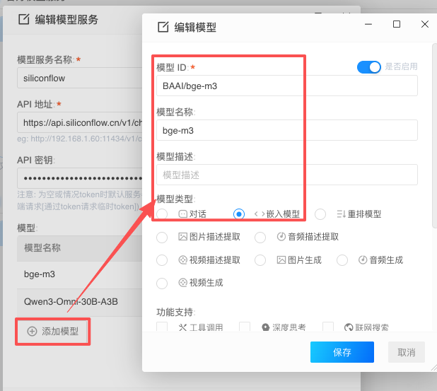
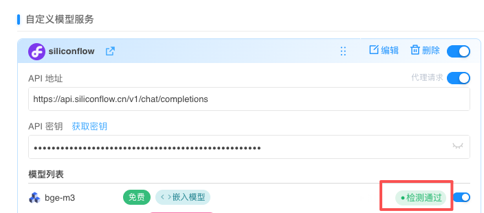
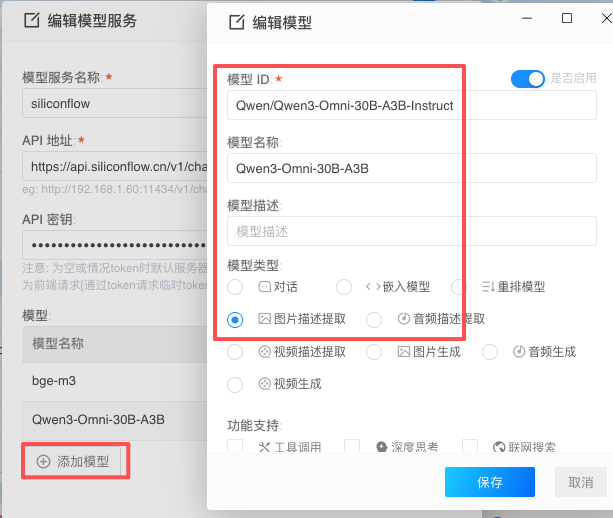
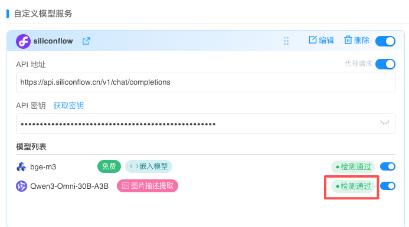
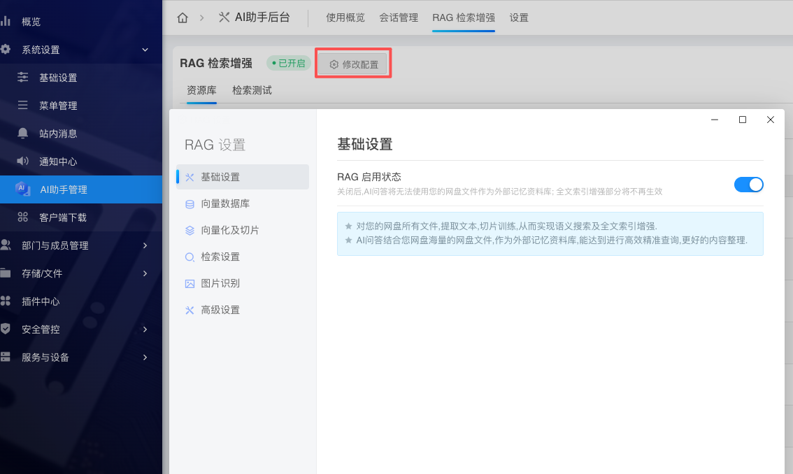
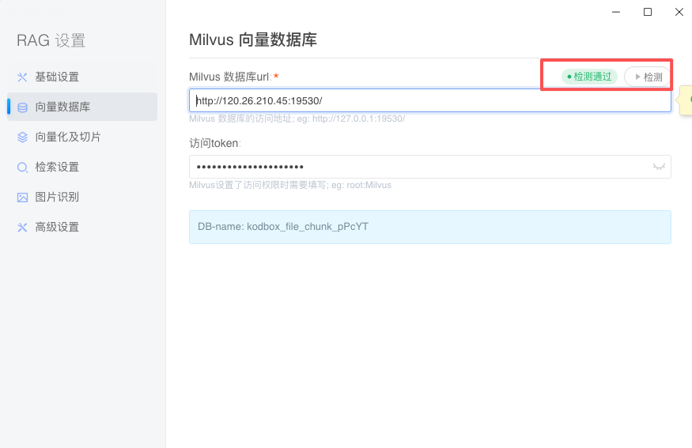
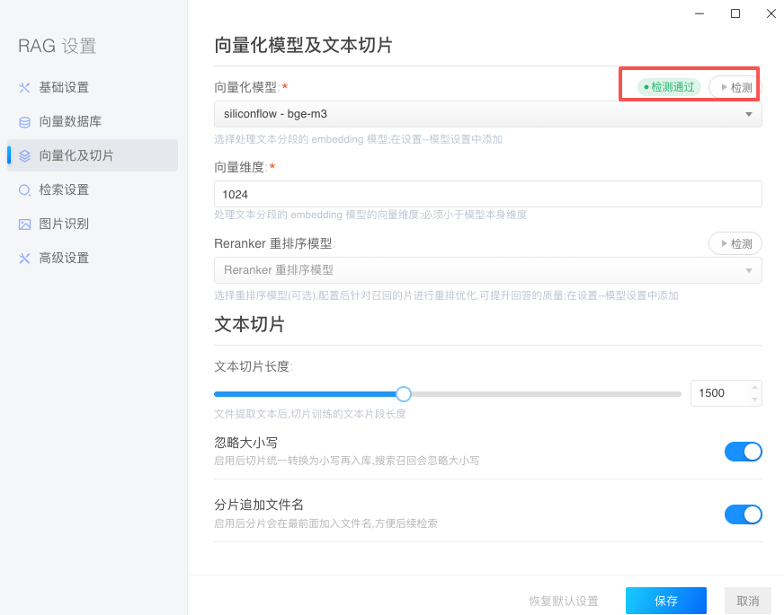
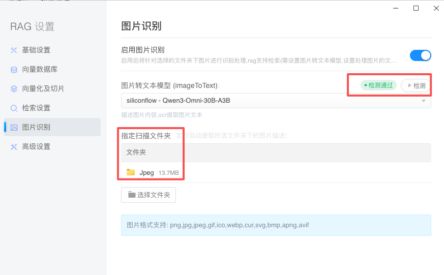
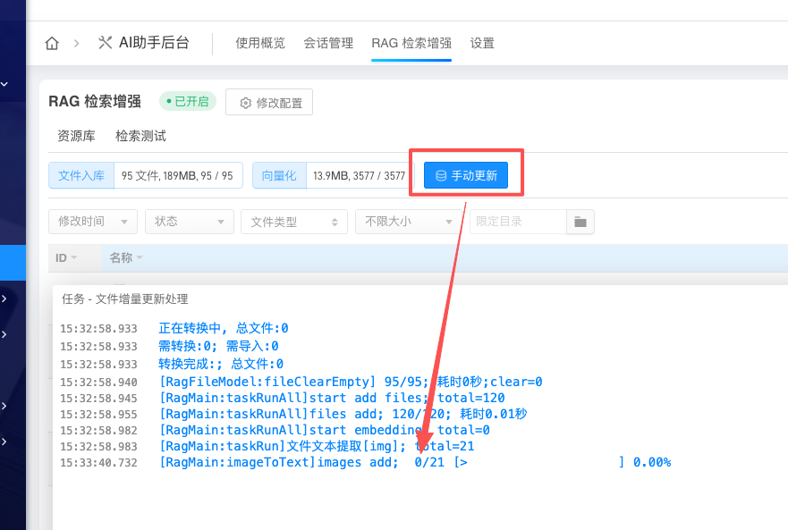

<div id="aidoc" class="tab-pane fade in active" markdown="1">

KodBox v1.69–v1.70.03 已将 AI 助手插件升级为**多模态创作 + 权限隔离知识库（`aiRag`）**一体化引擎。本指南分为「模型接入与多模态配置」「三类检索体系对比」「向量数据库与 `aiRag` 实战配置」三部分，帮助管理员快速上线企业级 AI 协同能力。

> **授权说明**
>
> AI 助手插件内置基础体验能力；如需接入自定义大模型、配置多模态创作接口或企业私有化向量知识库，需开通对应 **AI Pro 商业插件授权**（详见 [版本与授权对比](/start/editions/)）。
{: .important}

## 一、核心能力与 v1.70 多模态模型接入

### 1. 支持的模型模态全览（v1.70+）

新版 AI 助手引入了统一的模型参数配置与多模态调用框架，管理员可在插件后台按能力类型统一纳管不同厂商 API（兼容 OpenAI 协议、硅基流动、阿里云百炼、火山引擎豆包及本地 Ollama/vLLM）：

| 能力类别 | 典型任务场景 | 模型配置要点 |
| --- | --- | --- |
| **文本对话与网盘代理** | 读取网盘文件问答、文档总结、对话式文件整理/检索、自定义智能体分享 | 填写标准 `/v1/chat/completions` 基地址与模型 ID（如 DeepSeek、Qwen 等） |
| **ASR 语音转写** | 将网盘中的会议录音、访谈音频自动转为文字纪要 | 绑定语音识别模型端点，支持常见音频格式直转 |
| **TTS 语音合成** | 将文档摘要或对话结果合成为自然语音朗读 | 配置语音合成模型及音色参数 |
| **图像生成与编辑** | 文生图、图生图、局部图像编辑 | 适配支持 `images/generations` 与图像编辑接口的模型 |
| **视频生成** | 文生视频、首尾帧控制视频生成 | 配置异步任务轮询类视频模型接口与超时参数 |
| **3D 生成** | 基于文本或参考图生成 3D 资产模型 | 配置支持 3D 生成能力的专用多模态服务商接口 |

### 2. 常见模型服务商 API 适配示例

在 **后台管理 → 插件中心 → AI 助手 → 模型服务** 中新增服务商：

- **硅基流动（SiliconFlow）**：
  - API 地址：`https://api.siliconflow.cn/v1/chat/completions`
  - API 密钥：在硅基流动控制台 [API 密钥页](https://cloud.siliconflow.cn/me/account/ak) 创建。
- **阿里云百炼（DashScope 兼容模式）**：
  - API 地址：`https://dashscope.aliyuncs.com/compatible-mode/v1/chat/completions`
- **火山引擎 / 豆包（Ark）**：
  - 支持接入豆包大语言模型及多模态生成接口。填写火山方舟提供的兼容 OpenAI 接入点（`https://ark.cn-beijing.volces.com/api/v3/chat/completions` 或对应多模态端点），**模型 ID 需填写你在方舟控制台创建的推理接入点 ID（Endpoint ID，如 `ep-xxxxxxxx`）或对应官方模型标识**，并使用方舟 API Key 鉴权。
- **内网私有化模型（Ollama / vLLM）**：
  - 填写内网可达地址（Docker 同机部署时避免填 `localhost`，应使用宿主机内网 IP 或 Docker 网络服务名）。



## 二、三大检索体系对比：文件名检索 vs 全文检索 vs `aiRag` 语义检索

KodBox 当前提供三层互补的文档检索能力，管理员可按团队需求与算力成本合理组合，不必盲目全开：

| 对比维度 | 基础检索（内置免费） | 全文检索插件（`docsearch`，企业版） | AI 智能语义检索（`aiRag`，v1.70+） |
| --- | --- | --- | --- |
| **检索方式** | 文件名、拼音、标签、路径、纯文本（`.txt`）匹配 | 精确关键词倒排索引（MySQL Fulltext + ngram） | 语义向量相似度检索 + 图片内容理解 + AI 归纳问答 |
| **覆盖格式** | 文件元数据 + 纯文本 | PDF、Word、Excel、PPT 等办公文档文字 | 文档正文 + 多模态模型提取的图片描述 |
| **前置依赖** | 无额外依赖 | 需安装 **Java 11+** 及 MySQL InnoDB 全文索引 | 需部署 **Milvus 向量数据库** + 嵌入模型（Embedding）+（可选）图生文模型 |
| **典型提问示例** | 搜「2026年Q3财报」 | 搜包含精确字样「违约金比例 5%」的所有合同 | 问「去年华东区代理协议里的付款周期和违约条款怎么规定的？」 |
| **权限隔离** | 遵循网盘文档权限 | 遵循网盘文档权限 | **v1.70.03 优化 RAG 文件权限隔离**：严格按当前用户实时文档权限过滤向量召回，杜绝跨部门越权泄密 |

如需配置传统关键词全文检索，请参见 [全文搜索插件配置](/admin/docsearch/)。

## 三、部署向量数据库与配置 `aiRag` 语义检索

### 1. 部署 Milvus 单机版向量数据库

向量数据库用于持久化文档切片的语义向量。以下使用官方 Compose 编排启动（也可参考 [Milvus 官方文档](https://milvus.io/docs/zh/install_standalone-docker-compose.md)）：

```bash
mkdir -p /opt/milvus && cd /opt/milvus
wget http://static.box.kodcloud.com/update/milvus-standalone-docker-compose.yml -O docker-compose.yml
docker compose up -d
```

正常启动后可见三个容器：`milvus-etcd`、`milvus-minio`、`milvus-standalone`（默认 API 端口 `19530`）。

### 2. 添加向量/嵌入模型（Embedding）

嵌入模型负责将文档正文转换为高维向量：

1. 在已配置的模型服务中选择或搜索 `BAAI/bge-m3`（中英文长文本表现优秀）。
2. 添加模型：
   - **模型 ID**：`BAAI/bge-m3`
   - **模型名称**：自定义便于识别的名称
   - **模型类型**：选择 **嵌入模型**
3. 保存后点击「检测」，确认返回连接正常。





### 3. 添加图生文本模型（可选，用于图片语义检索）

若希望 AI 能通过语义检索找到网盘中的扫描件、海报、产品图：

1. 搜索多模态视觉模型（如 `Qwen/Qwen3-Omni-30B-A3B-Instruct` 或同等视觉理解模型）。
2. 添加模型，**模型类型**选择 **图片描述提取**。
3. 保存并点击检测通过。





### 4. 按顺序启用并完成 RAG 配置

1. 在 AI 助手插件设置中开启 **启用 RAG**。
   
2. 填入 **Milvus 向量数据库地址**（如 `http://<宿主机IP>:19530`）并点击检测通过。
   
3. 指定已验证通过的 **嵌入模型**。
   
4. （可选）指定 **图片描述提取模型**，并勾选需要纳入知识库扫描的文件夹范围。
   
5. 保存设置，等待计划任务自动入库向量化，或点击 **立即手动更新** 触发首次索引构建。
   

## 四、验证配置是否生效（Success Check）

完成配置后，请务必同时验证**问答可用性**与**权限隔离性**：

1. **功能验证**：在已纳入索引的目录中放入一份测试 PDF/Word 文档，待向量化完成后在 AI 助手中提问该文档的语义问题，确认回答准确并附带对应网盘文件来源。
2. **多模态验证**：按已配置的多模态能力测试一次文生图或音频转写，确认接口返回正常、生成结果可保存至网盘。
3. **权限隔离验证（v1.70.03+ 必测）**：使用**无权访问该测试目录**的普通测试账号登录，向 AI 助手提相同问题，确认系统不会召回或泄露无权限文件内容。

## 相关延伸

- 传统关键词全文检索：[全文搜索插件配置](/admin/docsearch/)
- 权限模型详解：[组织架构与细粒度权限模型](/concepts/permissions-model/)
- 端口放行参考：[网络端口与反向代理配置总表](/reference/ports-and-proxy/)

</div>
