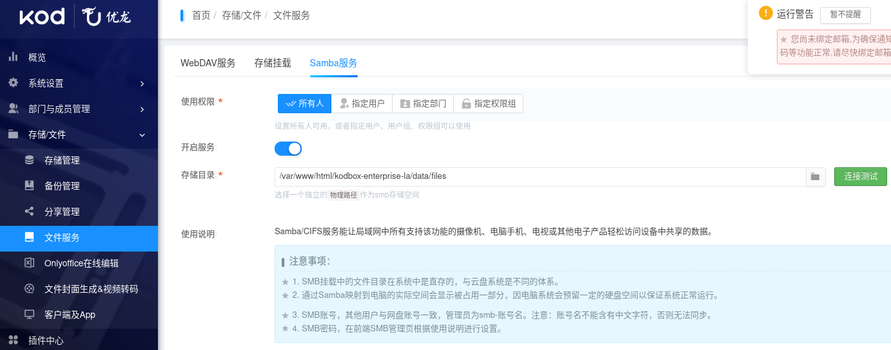
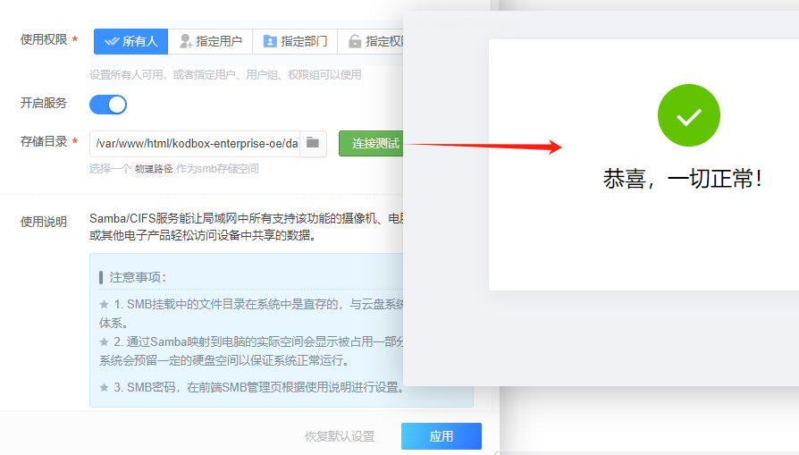
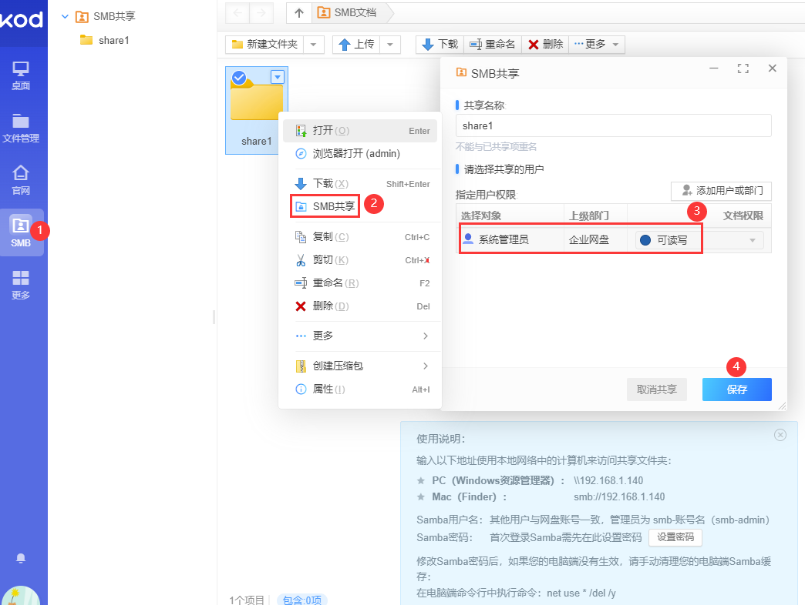
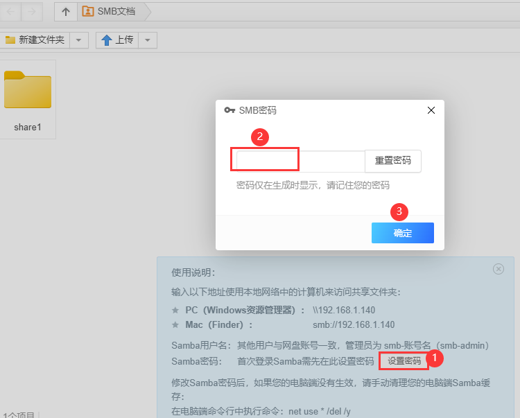
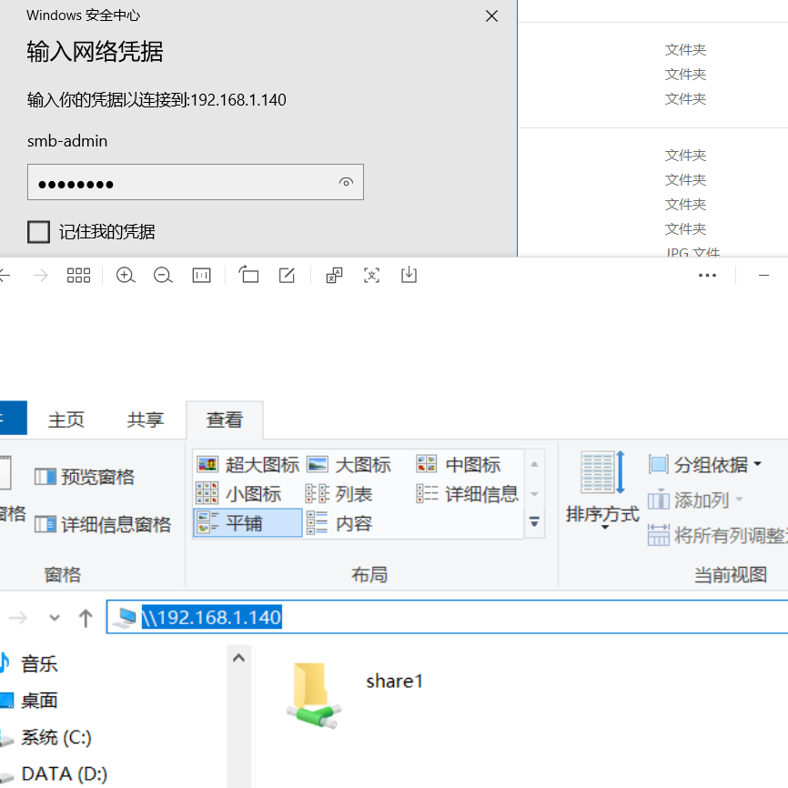

## 环境要求

- 此samba 插件仅适用于安装了 基于openEuler的teamOS 系统环境(默认包含)。
- [teamOS系统安装参考](https://bbs.kodcloud.com/d/3789)

## 插件介绍

Samba/CIFS服务能让局域网中所有支持该功能的摄像机、电脑手机、电视或其他电子产品轻松访问设备中共享的数据。

> **注 意**
> 
> - SMB存储是一个单独目录, 和网盘部门数据是隔离的。
> - SMB用户首次登录前需要设置密码, SMB密码和网盘密码不通用。
> - SMB管理员名称有smb-前缀, 如smb-admin, 其他SMB用户名不变。
{: .important}

## 配置说明

1. 进入后台 **存储** - **文件服务** - **samba服务**, 打开Samba插件配置

    {:width="800px"}

2. 连接测试成功, 应用插件配置

    {:width="600px"}
3. 进入文件管理页, 在左侧菜单打开SMB页面, 新建一个共享目录如share1 并设置相应权限

    {:width="600px"}
4. 注意SMB首次登录前需要设置密码

    {:width="500px"}
5. 在个人PC连接SMB

    {:width="400px"}

