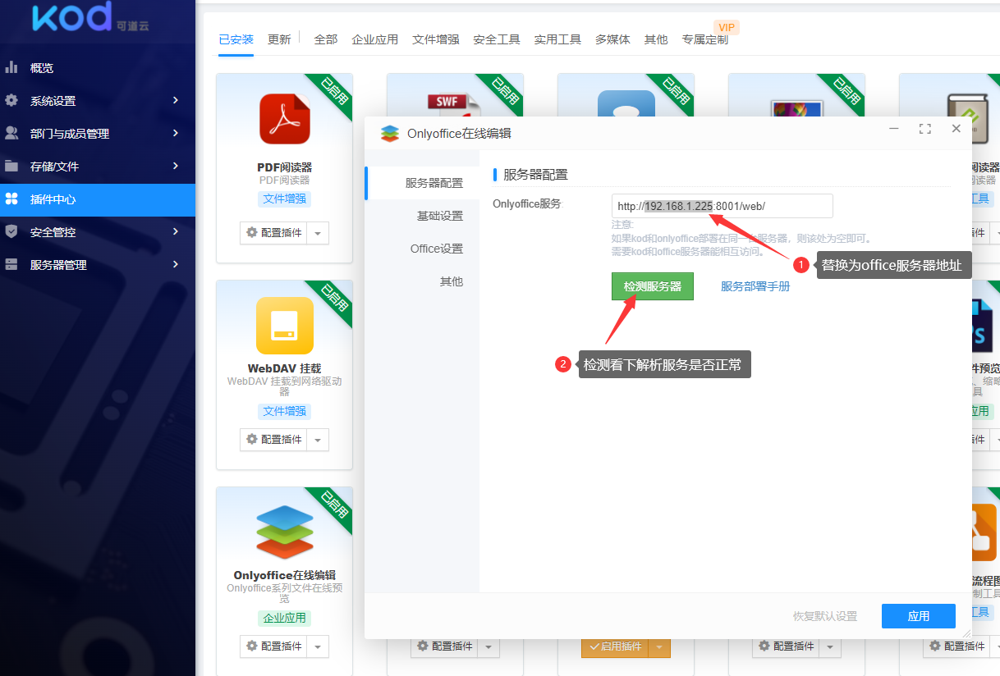
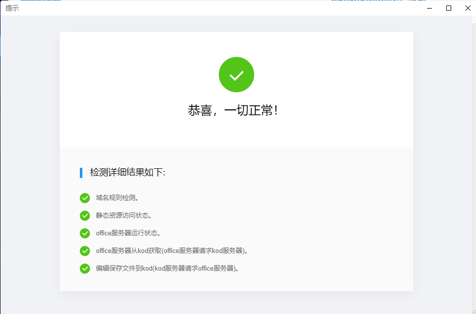

<div id="setup" class="tab-pane fade in active" markdown="1">

本指南按「网络拓扑检查 → 安全与协议对齐（HTTPS + JWT） → 权限与保存预期管理」三步，帮助你通过 Docker 完成 OnlyOffice 文档服务部署，并接入 KodBox（全面适配 v1.70+ JWT 开关与内网优先地址保留特性）。

## 环境要求与前置条件

- 操作系统：Ubuntu 22.04 / 24.04 LTS、Debian 12、openEuler 22.03 LTS 及以上（Anolis OS 8、银河麒麟 V10、龙芯 Loongnix 均支持）。
- 服务器可用内存 **4 GB 以上**（轻度测试最低 2 GB），已安装 Docker 及 Compose 插件。
- KodBox 建议升级至 **v1.70.03+**，并在插件中心安装 **onlyoffice 插件**（v2.06 起已免费开放）。
- **强制协议对齐原则**：若 KodBox 启用了 HTTPS，**OnlyOffice 必须同步启用 HTTPS**，否则浏览器会拦截混合内容，导致文档白屏或检测失败。

> **提示**
>
> 从 OnlyOffice Docs 9.4 起，开源社区版已取消 20 个同时连接数限制，详见 [OnlyOffice 官方博客](https://www.onlyoffice.com/blog/2026/05/onlyoffice-docs-9-4)。

## 1. 安装 Docker

Docker 是容器运行平台。若尚未安装，请先安装并启动 Docker 服务：

```bash
curl -fsSL https://get.docker.com | bash -s docker --mirror Aliyun
systemctl enable docker && systemctl start docker
```

## 2. 使用 Compose 部署 OnlyOffice 容器并启用 JWT

在项目目录创建 `compose.yml`。`JWT_SECRET` 中的示例值部署前**必须修改为你自己的随机密钥**（可用 `openssl rand -hex 32` 生成），并在 KodBox 插件配置页填入完全一致的密钥。

```yaml
services:
  kodoffice:
    image: registry.cn-hangzhou.aliyuncs.com/kodcloud/onlyoffice:10.0.0.1
    pull_policy: never
    container_name: kodoffice
    privileged: true
    restart: unless-stopped
    ports:
      - "${OFFICE_PORT:-8001}:80"
    environment:
      JWT_ENABLED: "true"
      JWT_SECRET: "kodbox_onlyoffice_2026"   # 示例密钥，部署前必须修改
      ALLOW_PRIVATE_IP_ADDRESS: "true"
      USE_UNAUTHORIZED_STORAGE: "true"
      GENERATE_FONTS: "true"
    volumes:
      - /usr/share/kodoffice/fonts:/usr/share/fonts/truetype/chinese:ro
    logging:
      driver: json-file
      options:
        max-size: "50m"
        max-file: "3"
```

启动前把中文字体（`.ttf` / `.otc`）放到宿主机 `/usr/share/kodoffice/fonts`，然后拉取镜像并启动容器：

```bash
mkdir -p /usr/share/kodoffice/fonts /kodoffice
cd /kodoffice
docker pull registry.cn-hangzhou.aliyuncs.com/kodcloud/onlyoffice:10.0.0.1
docker compose up -d
```

等待 1～3 分钟，浏览器访问 `http://[域名或IP]:8001/web/`。页面显示 `success,运行正常` 即表示容器已就绪。若可道云站点已启用 HTTPS，请勿直接填写此 HTTP 地址，继续完成下一节的 HTTPS 反向代理。

关键参数说明：

- `ALLOW_PRIVATE_IP_ADDRESS`：允许文档服务访问内网地址。可道云与 OnlyOffice 在同一内网或同 Docker 网络时必须开启，否则无法回源下载文件。
- `USE_UNAUTHORIZED_STORAGE`：允许拉取未带存储鉴权头的文件地址，可道云保存回调依赖此项。
- `JWT_ENABLED` / `JWT_SECRET`：开启令牌鉴权，防止未经授权的外部站点盗用你的 OnlyOffice 服务（配合 KodBox v1.70+ 插件的 JWT 开关使用）。
- `GENERATE_FONTS`：启动时根据挂载字体生成缓存，加快中文文档打开。

其他架构仅需替换 `image`：

- 龙芯（3A5000、3A6000 等 LoongArch64）：`registry.cn-hangzhou.aliyuncs.com/kodcloud/kodoffice:loongarch64`
- ARM 架构官方社区版：`onlyoffice/documentserver:10.0.0.1`

编辑文件较多时，可增加缓存持久化挂载避免撑爆容器层：`./office-data:/var/lib/onlyoffice`。

## 3. HTTPS 与反向代理 {: #https}

容器内部只监听 HTTP（默认映射本机 `8001`）。可道云启用 HTTPS 时，由宿主机 Nginx 终止 TLS 并转发至 `8001`。先在 `nginx.conf` 的 `http` 块中配置以下两段 `map`（与 `server` 同级）：

```nginx
map $http_x_forwarded_proto $the_scheme {
    default $http_x_forwarded_proto;
    ""      $scheme;
}

map $http_upgrade $proxy_connection {
    default upgrade;
    ""      close;
}
```

改完配置后校验并重载：

```bash
nginx -t && nginx -s reload
```

### 二级目录（建议） {: #office-subpath}

可道云已占用 443 时，推荐将 OnlyOffice 挂到同一域名的 `/office/`。Compose 中端口可收敛为 `127.0.0.1:8001:80`，无需对公网暴露 `8001`。在可道云所在 `server` 块中追加：

```nginx
location /office/ {
    proxy_pass http://127.0.0.1:8001/;
    proxy_http_version 1.1;
    proxy_connect_timeout 300s;
    proxy_send_timeout 300s;
    proxy_read_timeout 300s;

    proxy_set_header Upgrade $http_upgrade;
    proxy_set_header Connection $proxy_connection;
    proxy_set_header X-Forwarded-Host $http_host/office;
    proxy_set_header X-Forwarded-Proto $the_scheme;
    proxy_set_header X-Forwarded-For $proxy_add_x_forwarded_for;
}
```

插件服务地址填写 `https://域名/office/web/`。浏览器先访问该地址确认显示 `success,运行正常` 再做插件检测。

### 独立域名或端口

若使用独立域名或独立端口（如 `8443`），配置单独的 `server`：

```nginx
server {
    listen 8443 ssl http2;
    server_name office.example.com;

    ssl_certificate     /etc/nginx/ssl/office.example.com.crt;
    ssl_certificate_key /etc/nginx/ssl/office.example.com.key;
    ssl_protocols       TLSv1.2 TLSv1.3;
    ssl_prefer_server_ciphers on;
    ssl_session_cache shared:SSL:10m;
    ssl_session_timeout 10m;

    location / {
        proxy_pass http://127.0.0.1:8001/;
        proxy_http_version 1.1;
        proxy_connect_timeout 300s;
        proxy_send_timeout 300s;
        proxy_read_timeout 300s;

        proxy_set_header Host $host;
        proxy_set_header Upgrade $http_upgrade;
        proxy_set_header Connection $proxy_connection;
        proxy_set_header X-Forwarded-Host $http_host;
        proxy_set_header X-Forwarded-Proto $the_scheme;
        proxy_set_header X-Forwarded-For $proxy_add_x_forwarded_for;
    }
}
```

插件服务地址填写 `https://office.example.com:8443/web/`（使用 443 端口时去掉 `:8443`）。

### 自签名证书放行回源

若可道云站点本身使用自签名证书，OnlyOffice 容器默认会拒绝回源拉取文件，请在容器内关闭证书严格校验：

```bash
docker exec -it kodoffice bash
sed -i.bak '/rejectUnauthorized/ s/true/false/g' /etc/onlyoffice/documentserver/default.json
bash documentserver-update-securelink.sh
```

## 4. 在 KodBox 插件中心配置与内网回环优化

### 4.1 填写基础配置与 JWT 令牌（v1.70+）

1. 管理员登录 → **插件中心（全部）** → 安装并进入 **onlyoffice** 插件配置页。
2. **服务地址**：按接入方式填写并保留末尾 `/web/`（不能写 `localhost` 或 `127.0.0.1`）：
   - 内网直连：`http://[服务器IP]:8001/web/`
   - 二级目录：`https://域名/office/web/`（见 [二级目录](#office-subpath)）
   - 独立域名/端口：`https://office.example.com:8443/web/`（见 [HTTPS 与反向代理](#https)）
3. **JWT 鉴权开关与密钥（v1.70+）**：
   - v1.70 起插件支持显式控制 **JWT 开关**与回调端点鉴权。
   - 若容器开启了 `JWT_ENABLED=true`，请开启插件 JWT 开关并填入与 `JWT_SECRET` 完全一致的密钥；若容器未启用 JWT，请关闭插件 JWT 开关，否则必定报错令牌无效。

{:width="800px"}

### 4.2 同物理机部署回环失败与内网优先地址保留

社区最高频的检测失败场景是：**KodBox 与 OnlyOffice 部署在同一物理机或同 Docker 网络中，浏览器访问公网域名正常，但点击「检测 office 服务器」时最后一步（kod 服务器请求 office / office 请求 kod）失败**。

**根因**：路由器或云服务器安全组未开启 NAT 回环（Hairpin NAT），导致容器内部无法通过公网域名/公网 IP 访问同机服务。

**解决方案（三选一，推荐组合 1 + 2）**：

1. **利用 v1.70+ 二级目录与内网优先地址保留**：在插件配置中保留内网可互通的回调/服务地址（例如指向同网段局域网 IP 或同 Docker Compose 自定义网络服务名 `http://kodoffice/web/`），浏览器侧仍通过公网 HTTPS 地址加载编辑器。
2. **通过 `extra_hosts` 劫持同机域名解析**：在 KodBox 与 OnlyOffice 两个容器的 `compose.yml` 中均添加 `extra_hosts`，将公网域名直接解析到宿主机内网 IP：
   ```yaml
   extra_hosts:
     - "cloud.example.com:192.168.1.10"
     - "office.example.com:192.168.1.10"
   ```
3. **统一编排在同一 Docker 网络**：将 `kodbox` 与 `kodoffice` 放入同一个自定义 `bridge` 网络，并通过容器名互通。

## 5. 验证配置是否生效（Success Check）

1. 在插件配置页点击 **「检测 office 服务器」**，确认检测项全部通过（使用 OnlyOffice 官方原版社区镜像时，第 3、4 项检测可能提示不适用，属于正常现象）。
   {:width="600px"}
2. 刷新可道云页面，右键 `.docx` 文件选择 **打开方式 → onlyoffice 编辑**，输入文字并关闭标签页。
3. 等待保存回调完成（约 5–10 秒）后刷新目录并重新打开该文件，确认修改已持久化写入网盘。
4. 使用仅具备「预览者」权限的测试账号打开文档，核对只读与防下载/防打印行为符合预期。

## 6. 权限边界、保存回调与文档历史说明

### 预览者仍可下载或打印？

不同办公引擎对防下载/防打印的底层能力存在差异：

- **OnlyOffice** 会根据 KodBox 传入的文档权限隐藏或禁用编辑器的「下载」与「打印」菜单，但在「系统角色/文档权限」配置中需确保该账号**未勾选下载权限**（详见 [组织架构与细粒度权限模型](/concepts/permissions-model/)）。
- 若企业有极其严格的防截屏、防打印与强水印合规要求，需结合 [文档水印与安全管控](/admin/6/)，或评估永中 Office 等具备服务端渲染防下载能力的商业引擎。

### 编辑保存后立即下载读到旧内容？

OnlyOffice 在用户关闭最后一个编辑窗口后，会延迟数秒将最终文档通过异步回调接口（callback）写回 KodBox 服务器。如果在关闭编辑页面的**瞬间**直接点击下载，可能读到回调尚未落盘的旧版本。**建议关闭编辑页后等待 5–10 秒并刷新当前目录，再执行下载或分享**。

### 开启「文档历史」需要满足哪些条件？

要通过 OnlyOffice 编辑自动生成并可回溯文档历史版本，需同时满足：

1. KodBox 后台已启用「历史版本」相关功能与对应权限。
2. OnlyOffice 回调接口能够成功访问 KodBox（即 `office服务器请求kod` 畅通且 JWT 鉴权一致），使每次保存触发服务端版本写入。

## 7. 常见报错速查

### 提示「文档安全令牌的格式不正确」

该报错高发于**数据迁移、容器重建或重装 OnlyOffice 插件**之后，根因是 KodBox 插件保存的 JWT 密钥与 OnlyOffice 容器环境变量 `JWT_SECRET` 不一致（或一侧开启了 JWT 另一侧关闭）。

修复步骤：

1. 查看容器当前密钥：`docker exec kodoffice env | grep JWT`。
2. 核对 KodBox 插件配置页的 JWT 开关与密钥，确保两侧完全一致并点击保存。
3. 若修改了 `compose.yml` 中的 `JWT_SECRET`，必须执行 `docker compose up -d --force-recreate` 重建容器使其生效。
4. 清理浏览器缓存后重新打开文档。

### 开启 HTTPS 后文档白屏或检测失败

检查 OnlyOffice 服务地址是否仍为 `http://`。浏览器会直接阻断 HTTPS 页面内嵌 HTTP iframe，请按 [HTTPS 与反向代理](#https) 为 OnlyOffice 配置同级 HTTPS。

### 限制访问域名（仅适用kodoffice7.4）

```bash
docker exec -it kodoffice vim /var/www/onlyoffice/documentserver/web-apps/kod/allowhost.js
```

将允许调用的网盘域名填入白名单：

```javascript
window.kod.allowHost = [
        // 'kodcloud.com','*.kod.com',
        /*allowHostAdd*/
];
```

### 插件检测五项含义速查

- **域名规则检测**：必须为 IP 或域名，禁止 `localhost`。
- **静态资源访问状态**：检测 `[填写地址]/sdkjs/common/AllFonts.js` 是否可达。
- **office服务器运行状态**：失败时可重启容器内部服务 `docker exec -it kodoffice bash /app/ds/run-document-server.sh`。
- **office服务器请求kod**：检测容器内能否回调网盘（官方社区版镜像可忽略此项）。
- **kod服务器请求office**：检测网盘后端能否主动访问 OnlyOffice（失败多为 NAT 回环或防火墙阻断）。

### 离线部署与容器生命周期管理

- 无公网离线部署请提前导入镜像并保持 `pull_policy: never`。
- 常用管理命令（`docker compose down` 不会删除宿主机字体与缓存卷）：

```bash
docker compose restart
docker compose stop
docker compose down
```

## 相关延伸

- 完整排错字典：[告警与报错字典](/operations/error-dictionary/)
- 端口清单：[网络端口与反向代理配置总表](/reference/ports-and-proxy/)

</div>
